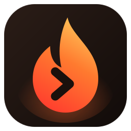
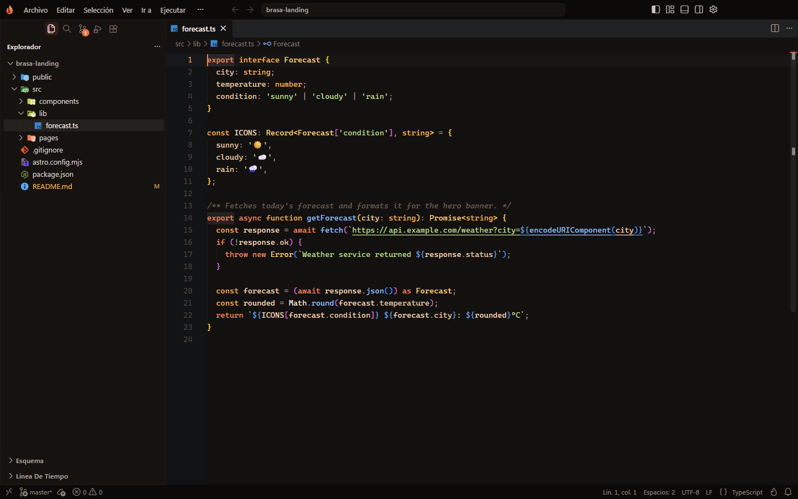
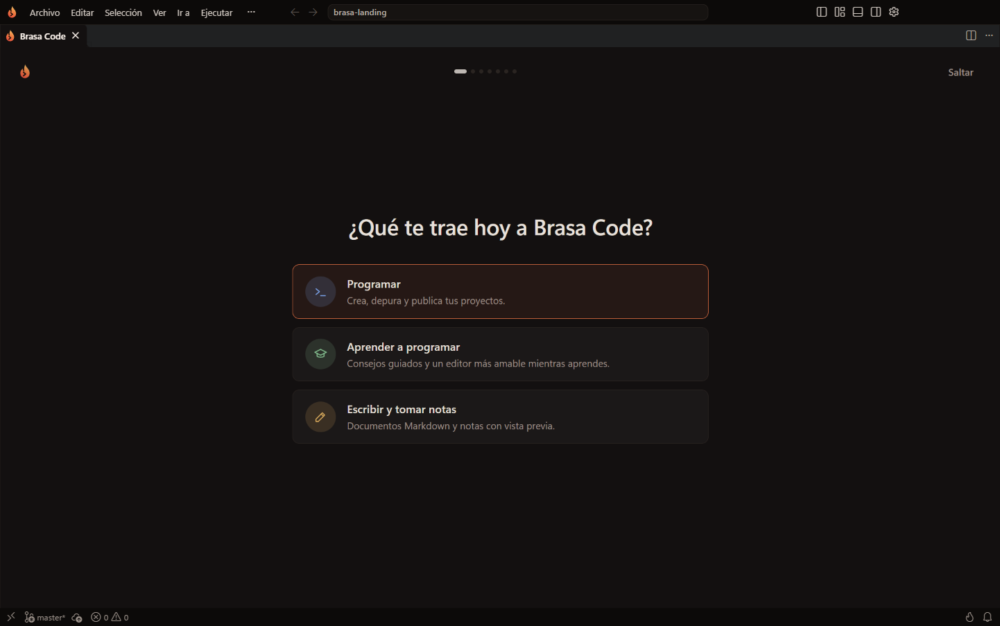
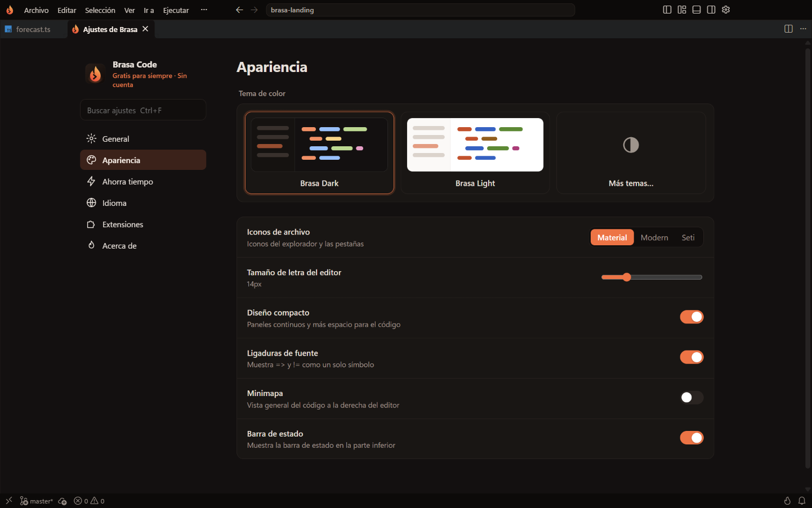
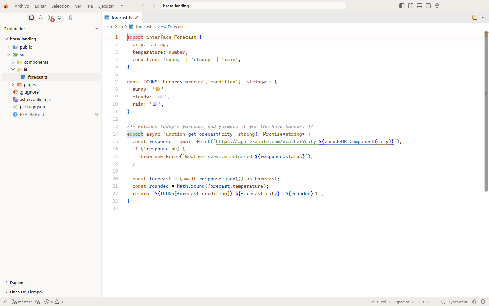

<p align="center">
  
</p>

<h1 align="center">Brasa Code</h1>

<p align="center">
  <strong>El editor de código gratis, rápido y privado.</strong><br>
  Sin cuentas. Sin IA de pago. Sin rastreo. Solo tú y tu código.
</p>

<p align="center">
  <a href="https://github.com/SifG22/brasa-code/releases/latest/download/BrasaCodeSetup.exe"></a>
</p>

<p align="center">
  <a href="https://github.com/SifG22/brasa-code/releases/latest"></a>
  
  
  
  <a href="https://open-vsx.org"></a>
</p>

<p align="center">
  <a href="README.md">English</a> · <b>Español</b>
</p>

<p align="center">
  
</p>

<p align="center">
  <a href="#descarga">Descarga</a> ·
  <a href="#por-qué-brasa-code">Por qué Brasa Code</a> ·
  <a href="#comparación">Comparación</a> ·
  <a href="#funciones">Funciones</a> ·
  <a href="#atajos-de-teclado">Atajos</a> ·
  <a href="#preguntas-frecuentes">Preguntas</a>
</p>

---

## Descarga

1. Descarga **[BrasaCodeSetup.exe](https://github.com/SifG22/brasa-code/releases/latest/download/BrasaCodeSetup.exe)** (2 MB).
2. Ábrelo. Busca la última versión, elige la adecuada para tu PC (x64 o ARM64), comprueba que la descarga está intacta y la instala. No necesita permisos de administrador.
3. A programar.

Para actualizar, vuelve a abrir `BrasaCodeSetup.exe`: siempre instala la versión más reciente y conserva tus ajustes y extensiones.

<details>
<summary>¿Prefieres el instalador completo de una versión concreta?</summary>

Todas las versiones están en [Releases](https://github.com/SifG22/brasa-code/releases):

- `BrasaCodeSetup-x64-<versión>.exe` para la mayoría de PCs (Intel y AMD).
- `BrasaCodeSetup-arm64-<versión>.exe` para PCs ARM (por ejemplo, Snapdragon). Puedes ver cuál es el tuyo en **Configuración > Sistema > Información > Tipo de sistema**.

Para comprobar una descarga, compara el resultado de este comando de PowerShell con `SHA256SUMS.txt`:

```powershell
Get-FileHash .\BrasaCodeSetup-x64-0.0.7.exe -Algorithm SHA256
```
</details>

**Requisitos:** Windows 10 u 11 de 64 bits (x64 o ARM64).

## ¿Por qué Brasa Code?

| | |
|---|---|
| 🔥 **Gratis para siempre** | Todas las funciones son gratis. No hay planes, ni pruebas, ni botón de "Pásate a Pro". |
| 🔒 **Privado por defecto** | Telemetría, experimentos, informes de errores y encuestas apagados. No se envía nada a ningún sitio salvo que tú lo pidas. |
| 🙅 **Sin cuenta** | Ni avisos para iniciar sesión ni menú de cuentas. Solo se usa GitHub cuando *tú* haces push o clonas con Git. |
| ▶️ **Ejecuta tu código en un clic** | C, C++, Python, JavaScript, Java, Go, Rust, C# y más. Si falta el compilador, Brasa te ofrece instalarlo gratis. |
| 🩺 **Errores explicados** | El panel Errores te dice, en palabras claras, qué significa cada error y cómo arreglarlo. Sin IA y sin cuenta. |
| ⚡ **Te ahorra horas** | Guardado automático, arreglos y formato al guardar, imports ordenados, renombrado de etiquetas pareadas y corrector ortográfico, listos desde el principio. |
| 🏠 **Como en casa** | Importa tus ajustes, atajos, snippets y extensiones de VS Code o Cursor en un clic. |
| 🧩 **Miles de extensiones** | Miles de extensiones gratis de [Open VSX](https://open-vsx.org). |
| 🌍 **Español e inglés** | Toda la interfaz está en los dos idiomas. |

## Comparación

|  | **Brasa Code** | VS Code | Cursor | Devin Desktop<br><sub>(antes Windsurf)</sub> |
|---|:---:|:---:|:---:|:---:|
| Precio | **Gratis, todo** | Editor gratis; Copilot tiene un plan gratis limitado y planes de pago | Plan gratis limitado; Pro desde 20 $/mes | Plan gratis limitado; Pro desde 20 $/mes |
| Funciona sin cuenta | ✅ | ✅ (Copilot necesita cuenta de GitHub) | El editor sí; la IA pide cuenta | El editor sí; la IA pide cuenta |
| Telemetría apagada de serie | ✅ | ❌ | Modo privacidad opcional | Configurable |
| Ejecutar código en un clic, con el compilador instalado por ti | ✅ | Con extensiones | Con extensiones | Con extensiones |
| Errores explicados en palabras claras, sin IA | ✅ | ❌ | ❌ | ❌ |
| Importar de VS Code **y** Cursor en un clic | ✅ | ❌ | Desde VS Code | Desde VS Code y Cursor |
| Asistente de IA integrado | ❌ Solo extensiones gratis | ✅ Copilot | ✅ | ✅ |
| Extensiones | Open VSX | Visual Studio Marketplace | Open VSX | Open VSX |

Brasa Code es para quien quiere un editor rápido, limpio y privado, sin suscripciones. Si lo que más necesitas es un agente de IA que escriba el código por ti, Cursor y Devin Desktop están pensados para eso.

<sub>Precios y planes a octubre de 2026. Consulta la web de cada producto para ver los datos más recientes.</sub>

## Funciones

### Un primer arranque que se adapta a ti

La primera vez que abres Brasa Code, una configuración corta te pregunta qué quieres hacer, tu idioma, tu estilo, de qué editor vienes y qué vas a crear. Después instala las herramientas gratis adecuadas: clangd para C/C++, las herramientas de Astro, Ruff para Python y más.

<p align="center">
  
</p>

### Ejecuta tu código

Pulsa el botón ▶ de arriba a la derecha, o <kbd>Ctrl</kbd>+<kbd>Alt</kbd>+<kbd>N</kbd>. Brasa compila si hace falta y ejecuta el programa en la terminal, donde puedes escribirle datos. Al terminar ves el código de salida y cuánto tardó.

- **Lenguajes:** C, C++, Python, JavaScript, TypeScript, Java, Go, Rust, C#, PHP, Ruby, Lua, Perl, R, Dart, PowerShell, Batch y Shell.
- **Programas de varios archivos:** en C y C++ se compilan juntos los archivos de la misma carpeta.
- **¿Falta el compilador?** Brasa lo detecta y te ofrece instalarlo gratis en un clic.
- **Tú eliges la ventana:** en la terminal integrada o en su propia ventana de consola (Ajustes de Brasa).

### El panel Errores

Todos los problemas del proyecto, agrupados por archivo, con filtros, una explicación en palabras claras de qué pasa y cómo arreglarlo, y botones para el arreglo rápido, ir a la línea o buscar el error en internet. Se puede abrir solo cuando ejecutas código con errores.

### Ajustes de Brasa

Todo lo importante en un solo sitio, sin sección de cuenta y sin nada que comprar. Ábrelo con <kbd>Ctrl</kbd>+<kbd>Mayús</kbd>+<kbd>J</kbd> o con la llama de la barra de estado.

<p align="center">
  
</p>

### Bonito de día y de noche

Dos temas ajustados a mano con una paleta cálida de brasa y sus propios colores de sintaxis, más los iconos de archivo Material. Los diálogos y las notificaciones también siguen tu tema.

<table>
  <tr>
    <td></td>
    <td></td>
  </tr>
  <tr>
    <td align="center">Brasa Dark</td>
    <td align="center">Brasa Light</td>
  </tr>
</table>

### Ahorradores de tiempo incluidos

| Función | Qué hace |
|---|---|
| Guardado automático | Los archivos se guardan mientras escribes. |
| Arreglar y formatear al guardar | Pasa tu formateador, aplica arreglos seguros del linter y ordena los imports. |
| Renombrar etiquetas pareadas | Al editar `<div>` también cambia `</div>`. |
| Actualizar imports al mover | Al mover o renombrar un archivo se actualizan todos los imports. |
| Corrector ortográfico | Detecta faltas en código, comentarios y Markdown, en español e inglés. |
| Desplazamiento fijo | La función y la clase actuales siguen visibles mientras te desplazas. |
| Soporte de lenguajes inteligente | Abre un archivo `.astro`, `.vue`, `.svelte`, `.mdx`, `.toml` o `.prisma` y Brasa te ofrece la extensión gratis adecuada en un clic. |

Todas se pueden activar o desactivar en **Ajustes de Brasa**.

## Atajos de teclado

| Atajo | Acción |
|---|---|
| <kbd>Ctrl</kbd>+<kbd>Alt</kbd>+<kbd>N</kbd> | Ejecutar el archivo actual |
| <kbd>Ctrl</kbd>+<kbd>Mayús</kbd>+<kbd>J</kbd> | Ajustes de Brasa |
| <kbd>Ctrl</kbd>+<kbd>P</kbd> | Ir a un archivo |
| <kbd>Ctrl</kbd>+<kbd>Mayús</kbd>+<kbd>P</kbd> | Paleta de comandos |
| <kbd>Ctrl</kbd>+<kbd>Ñ</kbd> | Terminal (teclado español) |
| <kbd>Ctrl</kbd>+<kbd>B</kbd> | Mostrar u ocultar la barra lateral |
| <kbd>F12</kbd> | Ir a la definición |
| <kbd>F2</kbd> | Renombrar en todo el proyecto |
| <kbd>Alt</kbd>+<kbd>Clic</kbd> | Añadir un cursor |

¿Vienes de otro editor? Elige su distribución de atajos (Sublime Text, IntelliJ, Vim, Eclipse o Notepad++) en la configuración inicial.

## Preguntas frecuentes

<details>
<summary><b>Windows dice "Windows protegió su PC". ¿Es seguro?</b></summary>

El instalador aún no está firmado digitalmente, así que SmartScreen muestra ese aviso con las descargas nuevas. Pulsa **Más información** y después **Ejecutar de todas formas**. El instalador solo descarga de las releases de este repositorio y comprueba el SHA256 de cada archivo antes de instalarlo.
</details>

<details>
<summary><b>¿De verdad es gratis? ¿Dónde está el truco?</b></summary>

No lo hay. Todas las funciones son gratis, sin cuenta y sin anuncios.
</details>

<details>
<summary><b>¿Brasa Code envía datos?</b></summary>

La telemetría, los informes de errores, los experimentos y las encuestas están apagados. Brasa Code solo se conecta cuando tú pides algo: instalar una extensión de Open VSX, descargar un compilador o usar Git con tu propio remoto.
</details>

<details>
<summary><b>¿Puedo usar IA?</b></summary>

Sí, si quieres. Brasa Code no trae IA de pago, pero puedes instalar cualquier extensión de IA de Open VSX o usar un asistente de IA en la terminal.
</details>

<details>
<summary><b>¿Funcionan mis extensiones de VS Code?</b></summary>

La mayoría, sí. Brasa Code usa [Open VSX](https://open-vsx.org), donde están las extensiones populares de cada lenguaje. La configuración inicial puede importar las que ya usas en VS Code o Cursor.
</details>

<details>
<summary><b>¿Cómo lo desinstalo?</b></summary>

Desde **Configuración > Aplicaciones > Aplicaciones instaladas** de Windows, como cualquier otra aplicación.
</details>

## Sugerencias y errores

¿Has encontrado un error o tienes una idea? [Abre un issue](https://github.com/SifG22/brasa-code/issues/new). Lo que cambia en cada versión está en [Releases](https://github.com/SifG22/brasa-code/releases).

## Acerca de

Brasa Code lo hace [SifG22](https://github.com/SifG22). Es gratis; su código fuente no es público.

Brasa Code incluye componentes de código abierto. Sus licencias y avisos van incluidos con la aplicación.

Brasa Code es un proyecto independiente y no está afiliado ni respaldado por Microsoft, Anysphere ni Cognition. "Visual Studio Code" y "VS Code" son marcas de Microsoft. "Cursor" es una marca de Anysphere. "Devin" y "Windsurf" son marcas de Cognition.

<p align="center">Hecho con 🔥 por <a href="https://github.com/SifG22">SifG22</a> · <a href="https://sifg.net">sifg.net</a></p>
