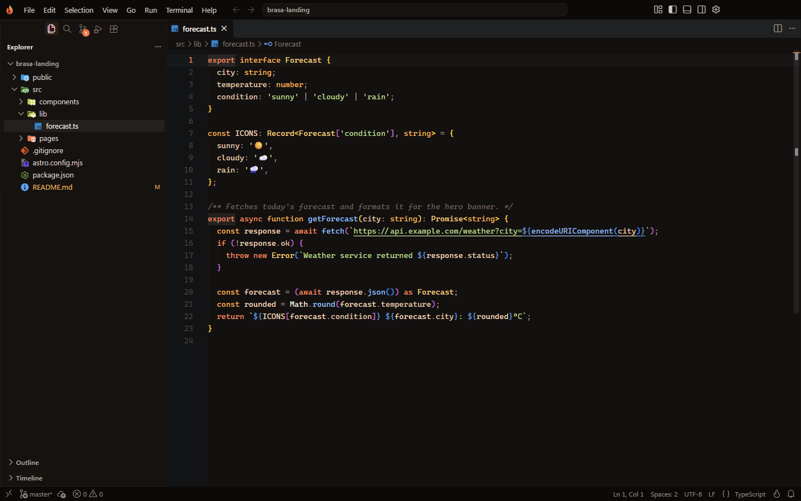
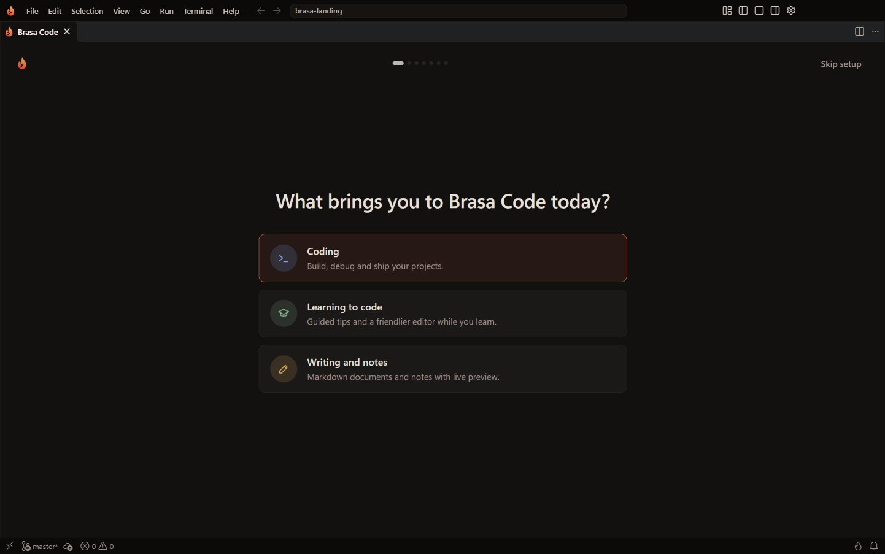
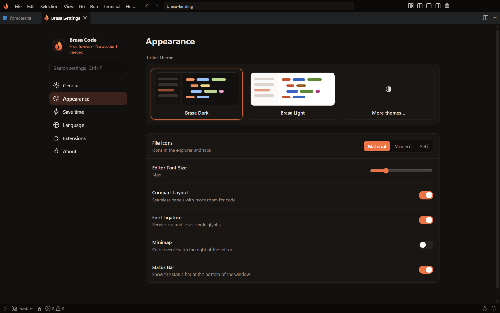
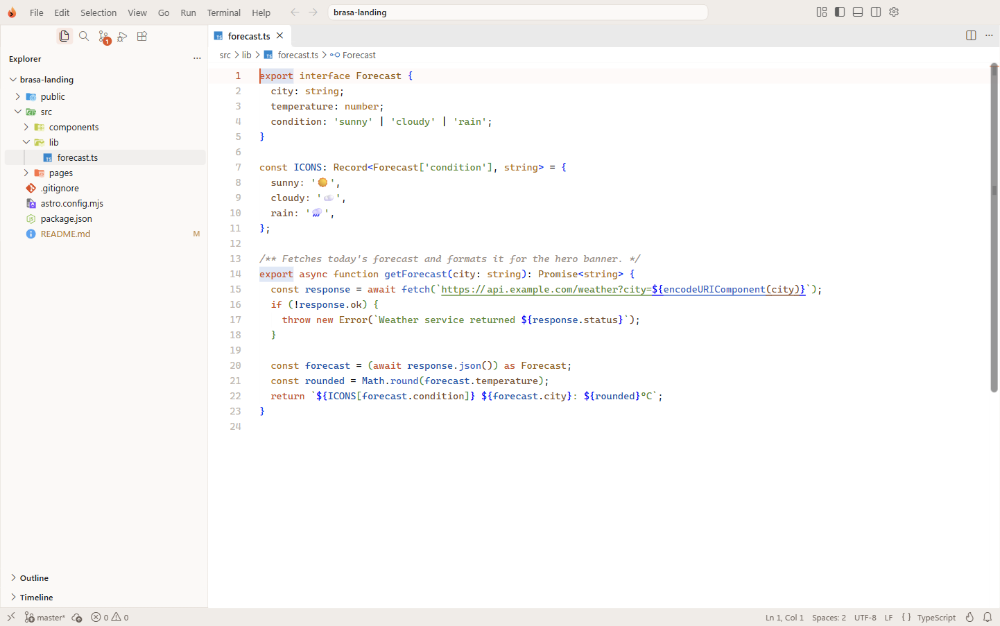

<p align="center">
  
</p>

<h1 align="center">Brasa Code</h1>

<p align="center">
  <strong>The free, fast and private code editor.</strong><br>
  No accounts. No paid AI. No tracking. Just you and your code.
</p>

<p align="center">
  <a href="https://github.com/SifG22/brasa-code/releases/latest/download/BrasaCodeSetup.exe"></a>
</p>

<p align="center">
  <a href="https://github.com/SifG22/brasa-code/releases/latest"></a>
  
  
  
  <a href="https://open-vsx.org"></a>
</p>

<p align="center">
  <b>English</b> · <a href="README.es.md">Español</a>
</p>

<p align="center">
  
</p>

<p align="center">
  <a href="#download">Download</a> ·
  <a href="#why-brasa-code">Why Brasa Code</a> ·
  <a href="#how-it-compares">Comparison</a> ·
  <a href="#features">Features</a> ·
  <a href="#keyboard-shortcuts">Shortcuts</a> ·
  <a href="#faq">FAQ</a>
</p>

---

## Download

1. Download **[BrasaCodeSetup.exe](https://github.com/SifG22/brasa-code/releases/latest/download/BrasaCodeSetup.exe)** (2 MB).
2. Run it. It finds the latest version, picks the right one for your PC (x64 or ARM64), checks that the download is intact and installs it. No admin rights needed.
3. Start coding.

To update, run `BrasaCodeSetup.exe` again: it always installs the newest version and keeps your settings and extensions.

<details>
<summary>Prefer the full installer of a specific version?</summary>

Every version is on the [Releases](https://github.com/SifG22/brasa-code/releases) page:

- `BrasaCodeSetup-x64-<version>.exe` for most PCs (Intel and AMD).
- `BrasaCodeSetup-arm64-<version>.exe` for ARM PCs (for example Snapdragon). You can check yours in **Settings > System > About > System type**.

To verify a download, compare the output of this PowerShell command with `SHA256SUMS.txt`:

```powershell
Get-FileHash .\BrasaCodeSetup-x64-0.0.7.exe -Algorithm SHA256
```
</details>

**Requirements:** Windows 10 or 11, 64-bit (x64 or ARM64).

## Why Brasa Code?

| | |
|---|---|
| 🔥 **Free forever** | Every feature is free. There is no plan, no trial and no "Upgrade to Pro" button. |
| 🔒 **Private by default** | Telemetry, experiments, crash reports and surveys are off. Nothing is sent anywhere unless you ask for it. |
| 🙅 **No account needed** | No sign-in prompts and no account menu. GitHub sign-in is only used when *you* push or clone with Git. |
| ▶️ **Run your code in one click** | C, C++, Python, JavaScript, Java, Go, Rust, C# and more. If a compiler is missing, Brasa offers to install it for free. |
| 🩺 **Errors explained** | The Errors panel tells you, in plain words, what each error means and how to fix it. No AI, no account. |
| ⚡ **Saves you hours** | Auto save, fix & format on save, organized imports, paired tag renaming and spell checking, ready out of the box. |
| 🏠 **Feels at home** | Import your settings, shortcuts, snippets and extensions from VS Code or Cursor in one click. |
| 🧩 **Huge extension library** | Thousands of free extensions from [Open VSX](https://open-vsx.org). |
| 🌍 **English & Spanish** | The whole interface is available in both languages. |

## How it compares

|  | **Brasa Code** | VS Code | Cursor | Devin Desktop<br><sub>(formerly Windsurf)</sub> |
|---|:---:|:---:|:---:|:---:|
| Price | **Free, everything** | Free editor; Copilot has a limited free plan and paid plans | Limited free plan; Pro from $20/month | Limited free plan; Pro from $20/month |
| Works without an account | ✅ | ✅ (Copilot needs a GitHub account) | Editor yes, AI needs an account | Editor yes, AI needs an account |
| Telemetry off out of the box | ✅ | ❌ | Optional privacy mode | Configurable |
| Run code in one click, compiler installed for you | ✅ | With extensions | With extensions | With extensions |
| Errors explained in plain words, without AI | ✅ | ❌ | ❌ | ❌ |
| One-click import from VS Code **and** Cursor | ✅ | ❌ | From VS Code | From VS Code and Cursor |
| Built-in AI assistant | ❌ Free extensions only | ✅ Copilot | ✅ | ✅ |
| Extension library | Open VSX | Visual Studio Marketplace | Open VSX | Open VSX |

Brasa Code is for people who want a fast, clean and private editor without subscriptions. If an AI agent writing code for you is what you need most, Cursor or Devin Desktop are built around that.

<sub>Prices and plans as of October 2026. Check each product's website for the latest details.</sub>

## Features

### A first run that adapts to you

The first time you open Brasa Code, a short setup asks what you want to do, your language, your style, the editor you come from and what you are going to build. It then installs the right free tools for you: clangd for C/C++, the Astro language tools, Ruff for Python, and more.

<p align="center">
  
</p>

### Run your code

Press the ▶ button at the top right, or <kbd>Ctrl</kbd>+<kbd>Alt</kbd>+<kbd>N</kbd>. Brasa compiles when needed and runs the program in the terminal, where you can type input into it. When it ends you see the exit code and how long it took.

- **Languages:** C, C++, Python, JavaScript, TypeScript, Java, Go, Rust, C#, PHP, Ruby, Lua, Perl, R, Dart, PowerShell, Batch and Shell.
- **Multi-file programs:** in C and C++ the files in the same folder are compiled together.
- **Missing compiler?** Brasa notices and offers to install it for free in one click.
- **Your choice of window:** run in the built-in terminal or in a console window of its own (Brasa Settings).

### The Errors panel

Every problem in your project, grouped by file, with filters, a plain-words explanation of what is wrong and how to fix it, and buttons for the quick fix, going to the line or searching the error online. It can open by itself when you run code that has errors.

### Brasa Settings

Everything that matters in one place, with no account section and nothing to buy. Open it with <kbd>Ctrl</kbd>+<kbd>Shift</kbd>+<kbd>J</kbd> or the flame in the status bar.

<p align="center">
  
</p>

### Looks great, day and night

Two hand-tuned themes with a warm ember palette and their own syntax colors, plus Material file icons. Dialogs and notifications follow your theme too.

<table>
  <tr>
    <td></td>
    <td></td>
  </tr>
  <tr>
    <td align="center">Brasa Dark</td>
    <td align="center">Brasa Light</td>
  </tr>
</table>

### Built-in time savers

| Feature | What it does |
|---|---|
| Auto save | Files are saved as you type. |
| Fix & format on save | Runs your formatter, applies safe lint fixes and organizes imports. |
| Rename paired tags | Editing `<div>` also updates `</div>`. |
| Update imports on move | Moving or renaming a file updates every import. |
| Spell checker | Catches typos in code, comments and Markdown, in English and Spanish. |
| Sticky scroll | The current function and class stay visible while you scroll. |
| Smart language support | Open an `.astro`, `.vue`, `.svelte`, `.mdx`, `.toml` or `.prisma` file and Brasa offers the right free extension in one click. |

Every one of them can be switched on or off in **Brasa Settings**.

## Keyboard shortcuts

| Shortcut | Action |
|---|---|
| <kbd>Ctrl</kbd>+<kbd>Alt</kbd>+<kbd>N</kbd> | Run the current file |
| <kbd>Ctrl</kbd>+<kbd>Shift</kbd>+<kbd>J</kbd> | Brasa Settings |
| <kbd>Ctrl</kbd>+<kbd>P</kbd> | Go to a file |
| <kbd>Ctrl</kbd>+<kbd>Shift</kbd>+<kbd>P</kbd> | Command palette |
| <kbd>Ctrl</kbd>+<kbd>`</kbd> | Terminal |
| <kbd>Ctrl</kbd>+<kbd>B</kbd> | Show or hide the side bar |
| <kbd>F12</kbd> | Go to definition |
| <kbd>F2</kbd> | Rename everywhere |
| <kbd>Alt</kbd>+<kbd>Click</kbd> | Add a cursor |

Coming from another editor? Pick its keyboard layout (Sublime Text, IntelliJ, Vim, Eclipse or Notepad++) in the first-run setup.

## FAQ

<details>
<summary><b>Windows says "Windows protected your PC". Is it safe?</b></summary>

The installer is not code-signed yet, so SmartScreen shows that warning for new downloads. Click **More info** and then **Run anyway**. The installer only downloads from this repository's releases and checks the SHA256 of every file before installing it.
</details>

<details>
<summary><b>Is it really free? What is the catch?</b></summary>

There is none. Every feature is free, with no account and no ads.
</details>

<details>
<summary><b>Does Brasa Code send any data?</b></summary>

Telemetry, crash reports, experiments and surveys are off. Brasa Code only goes online when you ask for something: installing an extension from Open VSX, downloading a compiler, or using Git with your own remote.
</details>

<details>
<summary><b>Can I use AI with it?</b></summary>

Yes, if you want to. Brasa Code has no built-in paid AI, but you can install any AI extension from Open VSX or use an AI assistant in the terminal.
</details>

<details>
<summary><b>Do my VS Code extensions work?</b></summary>

Most of them do. Brasa Code uses [Open VSX](https://open-vsx.org), where you will find the popular extensions for every language. The first-run setup can import the ones you already use in VS Code or Cursor.
</details>

<details>
<summary><b>How do I uninstall it?</b></summary>

From **Settings > Apps > Installed apps** in Windows, like any other app.
</details>

## Feedback

Found a bug or have an idea? [Open an issue](https://github.com/SifG22/brasa-code/issues/new). What changed in each version is on the [Releases](https://github.com/SifG22/brasa-code/releases) page.

## About

Brasa Code is made by [SifG22](https://github.com/SifG22). It is free to use; its source code is not public.

Brasa Code includes open source components. Their licenses and notices are included with the app.

Brasa Code is an independent project and is not affiliated with or endorsed by Microsoft, Anysphere or Cognition. "Visual Studio Code" and "VS Code" are trademarks of Microsoft. "Cursor" is a trademark of Anysphere. "Devin" and "Windsurf" are trademarks of Cognition.

<p align="center">Made with 🔥 by <a href="https://github.com/SifG22">SifG22</a> · <a href="https://sifg.net">sifg.net</a></p>
